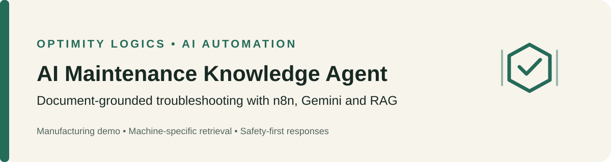

  

# AI Maintenance Knowledge Agent

A document-grounded manufacturing maintenance assistant built with **n8n, Google Gemini, retrieval-augmented generation (RAG), embeddings, a vector store, and Google Sheets**.

> **Safety notice:** This repository is a demonstration using synthetic training documents. It is not a certified maintenance system or a substitute for approved site procedures and qualified personnel.

## Overview

The agent helps technicians search machine-specific error codes, maintenance procedures, normal operating values, and service information. It is designed to answer from retrieved source documents, identify the source, and avoid inventing troubleshooting advice when evidence is missing.

| Item | Details |
|---|---|
| Workflow | n8n |
| Model | Google Gemini |
| Retrieval | Embeddings + n8n Simple Vector Store |
| Incident logging | Google Sheets |
| Sample equipment | HP-200 hydraulic press, CV-310 belt conveyor, AC-450 air compressor |
| Knowledge sources | Machine manuals, error-code reference, and safety SOP |

## Workflow

### 1. Ingest documents
1. Upload one PDF at a time through the n8n form.
2. Extract PDF text and retain the source filename as metadata.
3. Split text into 800-character chunks with 100-character overlap.
4. Generate Google Gemini embeddings.
5. Store chunks in the `maintenance_kb` Simple Vector Store collection.

### 2. Ask questions
1. A technician submits a question in the chat trigger.
2. The AI Agent calls `maintenance_search` to retrieve relevant chunks.
3. The response is grounded in retrieved text and names the source document.
4. If relevant evidence is not found, the agent is instructed to escalate to the maintenance supervisor.

### 3. Log incidents
The agent uses `log_incident` only when the technician explicitly requests logging. It repeats the machine ID, error code, summary, and severity and asks for confirmation before writing to Google Sheets.

## Important nodes

- **Upload maintenance documents:** PDF upload form.
- **Default Data Loader:** extracts PDF text and source metadata.
- **Recursive Character Text Splitter:** 800-character chunks, 100-character overlap.
- **Embeddings Google Gemini:** creates vector embeddings.
- **Simple Vector Store:** stores and retrieves chunks.
- **When chat message received / AI Agent:** handles technician questions.
- **maintenance_search:** retrieves the most relevant chunks.
- **log_incident:** appends a confirmed incident to Google Sheets.

## Safety and answer rules

The workflow prompt instructs the agent to:
- Answer only from documents returned by `maintenance_search`.
- Ask for a full machine ID when missing or incomplete.
- Search with the machine ID and error code together.
- Use information only when it matches the named machine.
- Include the issue, possible causes, recommended checks, safety note, and source for error-code questions.
- Never recommend bypassing, disabling, or overriding safety devices.
- Escalate when relevant evidence is missing.
- Log incidents only after an explicit request and confirmation.

## Repository contents

- `workflow/ai-maintenance-knowledge-agent.json` — sanitized n8n workflow export.
- `docs/AI_Maintenance_Knowledge_Agent_Optimity_Logics.md` — project overview and reported test notes.
- `docs/assets/project-banner.svg` — project banner.
- `docs/source-documents/` — readable Markdown transcriptions of the five supplied sample PDF sources.

## Setup

### Prerequisites
- An n8n instance with the AI/LangChain nodes used by the workflow.
- A Google Gemini API credential configured in n8n.
- A Google Sheets account and spreadsheet for incident logging.

### Import and configure
1. Import `workflow/ai-maintenance-knowledge-agent.json` into n8n.
2. Reconnect Google Gemini credentials for both the chat model and embeddings nodes.
3. Configure the Google Sheets credential on `log_incident`.
4. Replace `REPLACE_WITH_YOUR_GOOGLE_SHEETS_DOCUMENT_ID` with your own spreadsheet ID and verify the sheet/tab and column mapping.
5. Reconfigure webhook/form/chat nodes if required by your n8n version.
6. Upload the included PDFs through the document-upload form to populate the in-memory vector store.
7. Test the sample questions below before using the demo.

The workflow has been sanitized for sharing: account-specific credential references and the original spreadsheet identifier were removed or replaced. Credentials and the spreadsheet must be configured after import.

### Suggested incident sheet columns
`logged_at`, `machine_id`, `error_code`, `summary`, `severity`, `source_document`.

## Sample questions

- `HP-200 error E45`
- `CV-310 error E45`
- `AC-450 error E45`
- `HP-200 error E99`
- `What are the safety steps before working on the conveyor?`
- `Can I bypass the HP-200 door interlock?`
- `Log this incident`

## Testing noted in the supplied project documentation

The project overview reports successful tests for machine-specific E45 handling, unknown error escalation, incomplete machine IDs, refusal to bypass a safety interlock, conveyor safety-procedure retrieval after a prompt fix, and confirmation before incident logging. These are results recorded in the supplied documentation; they have not been independently re-run from this repository.

## Limitations and production considerations

- **In-memory vector store:** contents may not persist after restart. Consider a persistent vector database for production.
- **PDF extraction:** scanned files may need OCR.
- **Synthetic documents:** sample content is not validated operating guidance for real machinery.
- **Retrieval quality:** the project notes that service-history questions were less reliable; machine/document filters may improve results.
- **API quotas:** monitor Gemini usage and upload performance.
- **Governance:** production requires access controls, audit trails, retention rules, monitoring, and failure alerts.
- **Human oversight:** qualified staff must make and approve maintenance decisions.

## Security

Never commit API keys, OAuth tokens, passwords, personal data, or private production documents. Restrict access to workflows, source documents, and incident logs according to organizational policy.

Prepared for **Optimity Logics** as an AI automation demonstration.
